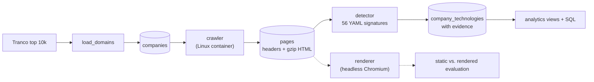

# Mini Technographics

[](https://github.com/dewa-ai/mini-technographics/actions/workflows/ci.yml)

A small-scale technographics pipeline: it crawls the homepages of the top 10,000 domains, detects the technologies each site uses from HTTP headers and HTML, stores everything in PostgreSQL, and answers business questions with SQL.

The goal was not only to build the pipeline, but to measure how trustworthy its output is. Most of this README is about what the data can and cannot tell you.

**Stack:** Python 3.12, PostgreSQL 17, Docker Compose, httpx + asyncio, psycopg 3, Protego, Playwright (evaluation only), pytest, ruff, uv



## Results at a glance

| | |
|---|---|
| Domains crawled | 10,000 (Tranco top list) |
| Main crawl throughput | 8,380 domains in 494 s (~17 domains/s, concurrency 50) |
| Homepages fetched | 5,513 (55.1%), about 5,000 unique sites after de-duplication |
| Technologies tracked | 56 across 22 categories |
| Pages with at least one detection | 90.1% |
| Static crawl coverage vs. a real browser | 73% overall, but only 25–34% for third-party tags |

## How it works

**1. Domain list.** `load_domains` streams the Tranco CSV and inserts domains in batches of 1,000 with `ON CONFLICT DO NOTHING`, so it is idempotent and never loads the full file into memory.

**2. Crawler.** An asyncio producer/consumer pipeline: N workers fetch homepages, one writer commits results every 100 domains.

- Separate timeouts (connect 3 s, read 10 s), so dead hosts fail fast while slow sites still get time.
- Streaming download capped at 256 KB; most fingerprints live in headers and `<head>`.
- HTTPS first, HTTP fallback, up to 10 redirects; the final URL is stored.
- robots.txt is honoured using Protego (RFC 9309). 429 and 5xx on robots.txt are treated as "stay away".
- Every outcome gets an explicit status (`ok`, `dns_failed`, `timeout`, `blocked`, `http_error`, `robots_disallowed`, `isp_blocked`, `error`) plus an error message, so "not crawled" is never confused with "uses no technology".
- Checkpointing: the crawler only picks `pending` rows, so an interrupted run resumes where it stopped. `--status timeout` re-crawls one failure class.
- An honest User-Agent that links to this repository.

**3. Detector.** Signatures live in `signatures.yaml` (header, cookie, meta generator and HTML regexes). `detect()` is a pure function with unit tests. Each detection stores its **evidence**, for example `header cf-ray: 8a1b…` or `html: cdn.shopify.com`, so any result can be verified in seconds. `implies` adds technologies that must be present, transitively (Next.js → React, WooCommerce → WordPress → PHP), and records them as `implied by …` so inferred and observed detections can always be separated. Pages are streamed with a server-side cursor, 200 at a time.

**4. Analytics.** The `sites` view collapses domains that redirect to the same host, and `site_technologies` exposes detections per unique site. Business questions are in `db/queries.sql`.

## Crawl outcomes

| Status | Domains | % | Meaning |
|---|---:|---:|---|
| ok | 5,513 | 55.1 | Homepage fetched |
| dns_failed | 1,612 | 16.1 | No website, mostly infrastructure domains (CDNs, APIs) |
| blocked | 1,135 | 11.4 | 401/403/429, usually bot protection |
| timeout | 1,054 | 10.5 | No response, even after a retry pass |
| robots_disallowed | 252 | 2.5 | Respected robots.txt |
| http_error | 249 | 2.5 | Other 4xx/5xx |
| error | 128 | 1.3 | Other connection errors, reason stored |
| isp_blocked | 57 | 0.6 | Redirected to a national block page |

**Timeouts are firewalls, not slow servers.** 92% of timeouts happened at TCP connect, and a low-concurrency retry recovered only 38 of 1,102 (3.4%). That points to silent packet drops (firewalls, geo-blocking). Timeout rates were uniform at about 11% across major TLDs, with `.tv` (29%), `.in` (24%) and `.ir` (22%) at roughly twice that rate (small samples, so indicative only).

## Evaluation: static crawl vs. a real browser

The crawler reads raw HTML without running JavaScript. To measure what that costs, 200 sites (one per unique host, fixed seed) were rendered in headless Chromium inside a container, and the same detector was run on both versions. The rendered side also includes every script URL the page requested.

- 190 sites compared; 2 excluded as soft blocks (bot challenges served with HTTP 200).
- The static crawl found **73%** of the technologies visible after rendering.
- Only 3 detections were found by the static crawl alone, so site changes between the two runs barely affect the result.

| Where the fingerprint lives | Example categories | Static coverage |
|---|---|---:|
| HTTP headers | CDN, hosting, web server | 98–100% |
| Page HTML | CMS, JS frameworks, fonts, UI frameworks | 84–90% |
| Injected by tag managers | Advertising, analytics, marketing automation | 25–34% |

Meta Pixel is the extreme case at **10%**: it is almost always loaded through Google Tag Manager, so it never appears in the raw HTML. Google Analytics is at 36%. The static crawl is roughly 20× faster than rendering, so this is a measured trade-off rather than a defect, but it matters: the technologies sales and marketing teams care most about are exactly the ones a static crawl misses most.

Full table: [`eval/static_vs_rendered.md`](eval/static_vs_rendered.md).

**Caveat:** both sides use the same detector, so this measures what the crawl method loses, not whether the signatures are correct. Measuring precision and recall needs human-verified labels; a blind, stratified sampler and a labelling helper are in `src/mini_technographics/evaluation/` for that next step.

## Data quality issues found and fixed

Each of these was found by inspecting results rather than trusting aggregate numbers.

- **Python's `urllib.robotparser` wrongly disallowed google.com.** It applies the first matching rule and ignores wildcards. Comparing it with Protego on the affected domains confirmed the bug; switching to Protego fixed it.
- **National block pages counted as successful crawls.** The crawl ran from an Indonesian network, where filtered sites (gambling, adult content) redirect to `internet-positif.info`. 57 domains looked like `ok` crawls with the block page's technologies. Found during gold-set sampling by grouping final URLs by host; these domains now get `isp_blocked` and the crawler recognises the block page.
- **One site, many domains.** 140 Google domains redirect to `www.google.com`. Analytics count unique sites, which lowers per-technology counts by 4–7%.
- **Soft blocks.** Some sites answer a headless browser with "Access Denied" or a captcha page and HTTP 200. The evaluation excludes rendered pages that are less than 25% of the static page's size. 6 of 200 sites (3%) accepted plain HTTP but blocked the browser.
- **React was under-detected.** Modern React leaves almost no trace in HTML: only 75 sites matched directly, 718 more come from `implies` (mostly Next.js). Read React counts as a lower bound.
- **Large companies show few detections, correctly.** github.com and apple.com run in-house infrastructure (`server: github.com`, `server: Apple`), so commodity signatures do not match. This is part of why 9.9% of pages have no detection.

## Analytics highlights

Most used technologies per unique site: Google Tag Manager (33.6%), Cloudflare (29.9%), jQuery (23.9%), PHP (20.7%), Nginx (20.2%).

Among sites with a detected CMS, WordPress has 68.8%, Drupal 18.9% and Webflow 10.1%. Most top sites run custom systems, so this is share among sites that use a common CMS.

Raw co-occurrence counts mostly reflect popularity, so pairs are ranked by **lift**, P(A and B) / (P(A) P(B)), using direct evidence only and at least 30 sites per pair:

| Pair | Lift | Reading |
|---|---:|---|
| Nuxt.js + Vue.js | 24.5 | Known dependency, a sanity check for the method |
| Adobe Experience Platform Tags + Akamai | 7.4 | Enterprise stack |
| Next.js + Vercel | 6.8 | Same vendor |
| HubSpot + WordPress | 4.0 | Marketing-led business sites |
| Adobe Experience Platform Tags + OneTrust | 3.6 | Enterprise stack |

`db/queries.sql` also builds a sample lead list: sites running analytics or ad tags with no detected cookie-consent tool. It is deliberately presented with its limits: the static crawl finds only about 61% of consent tools, and only two consent platforms are in the signature set, so the list overstates the gap. Signature coverage directly limits the quality of the product built on top.

Lookups by technology use `idx_company_tech_technology`; finding all Shopify sites takes about 0.5 ms (`EXPLAIN ANALYZE` in Q6).

## Design decisions

**The crawler runs in a Linux container.** Running it directly on macOS repeatedly triggered XProtect's behavioural detection (a script opening thousands of connections to unknown hosts). Reproduced with a controlled run, then fixed by containerising. This also isolates untrusted web content from the host and mirrors how crawlers run in production.

**Raw pages are stored, compressed.** Headers and gzip-compressed HTML are kept, so the detector can be improved and re-run without re-crawling.

**Rendering waits for DOMContentLoaded plus 3 s, not `load`.** Waiting for `load` timed out on 24 of 200 heavy pages; the switch reduced that to 2. Detections per rendered site stayed identical (4.52 in both runs), so nothing was lost.

**PostgreSQL is exposed on port 5433** to avoid clashing with a local PostgreSQL installation.

## Limitations and next steps

- **Fetch tag manager containers.** Google Tag Manager configs are plain JavaScript at `gtm.js?id=GTM-…`. A second HTTP request could recover much of the missing third-party coverage without a browser.
- **Human-labelled gold set** for real precision and recall (tooling is ready).
- **Wider signatures**, especially consent platforms and analytics vendors.
- **Vantage point.** All data was collected from one Indonesian network. Geo-blocking, national filtering and CDN routing differ elsewhere.
- **Recrawls.** `first_seen` and `last_seen` are in the schema, but adoption over time needs repeated crawls.
- **Scaling.** For millions of domains: a DNS pre-filter, skipping the homepage when robots.txt already failed at connect, a shared job queue with distributed workers, and object storage for raw pages.
- **API and dashboard** (FastAPI, TypeScript) are planned.

## Quickstart

Requires Docker and [uv](https://docs.astral.sh/uv/).

```bash
git clone https://github.com/dewa-ai/mini-technographics.git
cd mini-technographics
cp .env.example .env            # then set a real password
docker compose up -d            # PostgreSQL 17 on localhost:5433
uv sync

# 1. Domain list
mkdir -p data/raw
curl -L -o data/raw/top-1m.csv.zip https://tranco-list.eu/top-1m.csv.zip
unzip -o data/raw/top-1m.csv.zip -d data/raw/
uv run python -m mini_technographics.load_domains --limit 10000

# 2. Crawl inside a Linux container, then retry timeouts
docker compose --profile crawl run --rm crawler --limit 10000 --concurrency 50
docker compose --profile crawl run --rm crawler --status timeout --limit 2000 --concurrency 20

# 3. Detect technologies
uv run python -m mini_technographics.detector

# 4. Analytics
docker compose exec -T db psql -U techno -d technographics < db/analytics.sql
docker compose exec -T db psql -U techno -d technographics -P pager=off < db/queries.sql

# Optional: static vs. rendered evaluation
docker compose --profile render run --rm renderer --sample 200
uv run python -m mini_technographics.evaluation.compare_rendered
```

Tests and linting:

```bash
uv run pytest
uv run ruff check .
```

## Project layout

```
db/
  schema.sql          tables, created automatically on first start
  analytics.sql       sites / site_technologies views
  queries.sql         business questions
src/mini_technographics/
  load_domains.py     Tranco CSV -> companies
  crawler/            fetch.py, robots.py, __main__.py (runner)
  detector/           signatures.yaml, engine.py, __main__.py (runner)
  evaluation/         render.py, compare_rendered.py, make_goldset.py, label.py
eval/                 evaluation reports
tests/                unit tests
Dockerfile            crawler image
Dockerfile.render     renderer image (Chromium)
```
